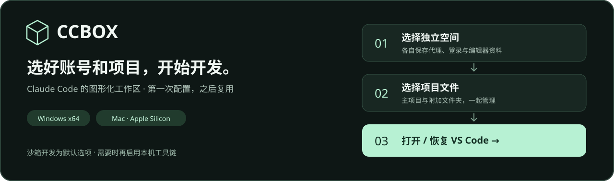
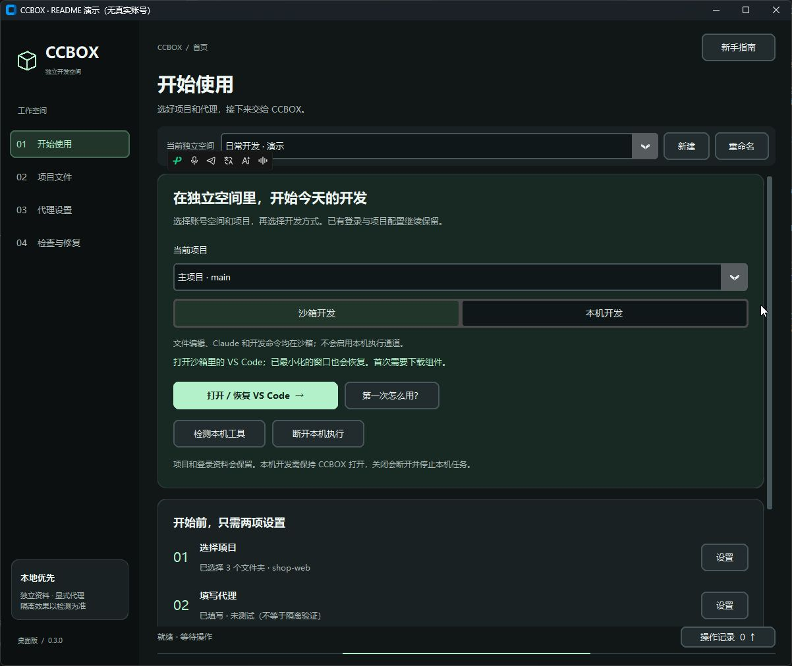
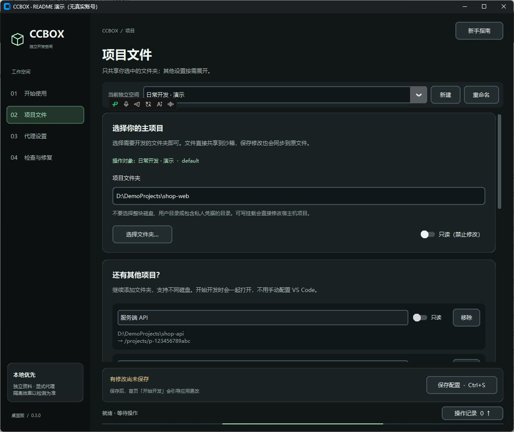
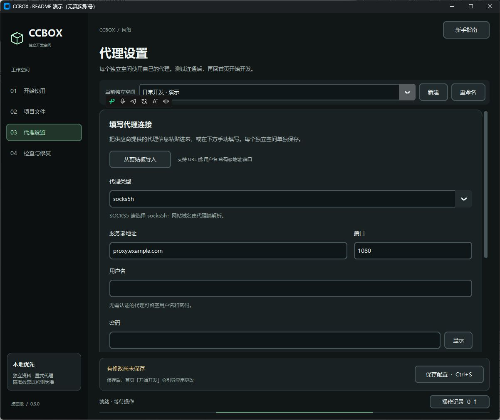

<p align="center">
  
</p>

<h1 align="center">CCBOX</h1>
<p align="center"><strong>给 Claude Code 配一个独立开发空间。选好账号和项目，开始开发。</strong></p>
<p align="center">
  <a href="https://github.com/3441293738/ccbox/releases/latest"><strong>下载最新版</strong></a> ·
  <a href="https://github.com/3441293738/ccbox/actions/workflows/build.yml">双平台构建</a> ·
  <a href="LICENSE">MIT 开源</a>
</p>
<p align="center">
  <a href="#下载">下载</a> · <a href="#界面预览">界面预览</a> · <a href="#windows-安装">Windows 安装</a> · <a href="#mac-安装">Mac 安装</a> · <a href="#第一次使用">第一次使用</a> · <a href="#常见问题">常见问题</a>
</p>

## 这是做什么的？

CCBOX 是一个 **Windows / M 系列 Mac 图形化工作区工具**。不用自己写容器配置，在界面里选择项目、配置代理，就能打开装有 Claude Code 的沙箱 VS Code。

- **CCBOX**：管理独立空间、项目、代理和启动入口。
- **Docker Desktop**：提供容器运行环境，需要单独安装并保持运行。
- **沙箱桌面**：在浏览器里显示容器中的 VS Code 和授权浏览器；编辑器与 Claude 后端在容器内运行。

已有 JDK、Maven、Node 等本机工具？也可以选择「本机开发」，让 Claude 经你确认后调用它们，不必把全部工具链重新装进容器。

> CCBOX 不附带 Claude 账号、订阅额度或代理服务。它不是 Anthropic、Microsoft 或 Docker 官方产品；使用者需自行具备相关服务的有效账号与使用资格。

## 下载

| 你的电脑 | 下载已打包版本 | 安装方式 |
|---|---|---|
| **Windows x64** | [下载 CCBOX-windows-x64.zip](https://github.com/3441293738/ccbox/releases/latest/download/CCBOX-windows-x64.zip) | 完整解压，双击 `CCBOX.exe` |
| **Mac · Apple Silicon**（M 系列） | [下载 CCBOX-macos-arm64.zip](https://github.com/3441293738/ccbox/releases/latest/download/CCBOX-macos-arm64.zip) | 解压，将 `CCBOX.app` 拖到「应用程序」 |

[查看全部版本与更新说明](https://github.com/3441293738/ccbox/releases) · [下载 SHA-256 校验文件](https://github.com/3441293738/ccbox/releases/latest/download/SHA256SUMS.txt)

**普通用户下载上面的安装包即可。** `Code → Download ZIP` 和 Release 底部的 `Source code` 是源码，不是安装包。已打包版本不需要自行安装 Python，也不需要执行制作命令。当前成品针对 Windows x64 和 Mac ARM64，不是 Windows ARM 或 Intel Mac 安装包。

## 界面预览

### 首页：选空间、选项目，然后打开编辑器



<details>
<summary><strong>展开查看：多项目管理与代理设置</strong></summary>

### 项目文件：多个目录，一起打开

主项目、附加项目可以来自不同磁盘；只用于参考的文件夹可设为只读。



### 代理设置：填写参数，测试后保存

支持 HTTP、HTTPS 和 SOCKS5；也提供从剪贴板导入的入口。



</details>

<sub>截图来自 v0.3.0 Windows 版的独立演示配置；账号名称、项目路径和代理地址均为示例，未展示真实登录资料。Mac 版操作流程相同，系统外观略有差异。详见[截图说明](docs/images/README.md)。</sub>

## 能帮你做什么？

| 功能 | 对日常使用有什么帮助 |
|---|---|
| **多个独立空间** | 分开保存代理、登录卷、浏览器和编辑器资料，切换时不混用账号配置 |
| **多个项目文件夹** | 一次添加前端、后端、参考代码，不用手写挂载配置；支持只读 |
| **完整沙箱 VS Code** | 编辑器、Claude 后端与授权浏览器在容器中运行，宿主浏览器负责显示桌面 |
| **可选本机开发** | 复用电脑已有的开发工具，每条本机命令先在 CCBOX 确认 |
| **代理配置** | HTTP / HTTPS / SOCKS5、认证信息、出口测试；SOCKS 目标域名由代理侧解析 |
| **自适应高清桌面** | 自动按浏览器窗口调整沙箱分辨率，支持宽屏 / 4K 上限与高清 / 流畅切换；[显示设置教程](docs/显示设置.md) |
| **窗口恢复** | 最小化后点「恢复 VS Code」，不用重新创建环境 |
| **可选局域网访问** | 另一台电脑通过内网地址与访问口令进入同一沙箱桌面；默认关闭，[查看教程](docs/局域网访问.md) |
| **文字与图片传送** | 手动粘贴、预览、确认后送入沙箱剪贴板，不自动同步宿主剪贴板 |
| **资料保留与目录管理** | 停止后保留登录卷；可选择工具数据目录，按需迁移配置 |

## Windows 安装

### 1. 准备 Docker Desktop

从 [Docker 官方 Windows 安装页](https://docs.docker.com/desktop/setup/install/windows-install/) 下载适合电脑的版本，按官方系统要求安装。一般使用 **WSL 2 后端和 Linux 容器**；如提示启用虚拟化、安装 WSL 或重启电脑，先完成这些步骤。

安装后打开 Docker Desktop，等引擎启动完成。**安装好了不等于已经运行**，使用 CCBOX 时请保持 Docker 运行。

### 2. 解压 CCBOX

下载上面的 Windows ZIP，右键解压到一个方便找到的目录，例如 `D:\Apps\CCBOX`。

- 解压**整个文件夹**，保留 `CCBOX.exe` 与运行组件的相对位置。
- 不要在压缩包内直接启动，也不要只把 EXE 拖到桌面。
- 想在桌面打开，可以为 `CCBOX.exe` 创建快捷方式。

### 3. 双击启动

双击 `CCBOX.exe`，继续下面的[第一次使用](#第一次使用)。默认沙箱方式不要求宿主机预装 Claude、Python 或 VS Code。

> 当前 Windows 成品未做 Authenticode 签名。遇到系统提示时，先核对下载来源与发布页校验值，遵循设备的安全策略。

## Mac 安装

### 1. 安装 Apple Silicon 版 Docker Desktop

点击苹果菜单 →「关于本机」，确认芯片为 **Apple M 系列**。到 [Docker 官方 Mac 安装页](https://docs.docker.com/desktop/setup/install/mac-install/) 选择 **Apple silicon** 版，安装并打开 Docker Desktop，等待引擎就绪。

### 2. 安装 CCBOX.app

1. 下载 `CCBOX-macos-arm64.zip`。
2. 双击 ZIP 解压，将 `CCBOX.app` 拖入「应用程序」。
3. 在「应用程序」中双击 CCBOX，继续[第一次使用](#第一次使用)。

**这是已经构建好的原生 ARM64 应用**，无需运行 `.command` 文件或自己制作应用。

### 3. 首次打开有系统提示怎么办？

当前 Mac 版本采用 ad-hoc 签名，**尚未 Apple 公证**。确认来源为本仓库 Release、校验文件匹配后，可依照 [Apple 官方打开应用说明](https://support.apple.com/zh-cn/102445)，在「系统设置 → 隐私与安全性」查看该应用对应的提示。

不要关闭整个系统的安全检查。若提示含恶意软件、损坏等异常，先停止安装并核对下载文件；公司管理的设备遵循管理员策略。

## 第一次使用

**顺序就是：选空间 → 选项目 → 填代理 → 打开编辑器 → 登录 Claude。** 首次准备会下载镜像和编辑器组件，请耐心等待操作记录中的完成提示。

### ① 选择一个独立空间

首次用「默认环境」即可。准备使用另一个账号时，点击顶部「新建」，给空间起一个容易区分的名字，例如「日常开发」「测试项目」。

这里的「新建」是新建本地空间，**不是注册 Claude 账号**。每个新空间需要自行登录。

### ② 添加你的项目

打开左侧「项目文件」→「选择文件夹…」，选择代码所在的文件夹。

- 多个项目：展开「还有其他项目？」并逐个添加，支持不同磁盘。
- 只看不改：勾选该目录的「只读」。
- 只共享实际需要的项目，不要直接选整个磁盘或用户主目录。

> **共享目录不是副本。** 在沙箱里修改这些文件，会直接修改电脑上的原项目。建议先用 Git 提交或备份；不要把密码、密钥等无关资料放进共享目录。

### ③ 配置代理并测试

进入「代理设置」，按代理服务提供者给出的参数填写：

| 输入项 | 怎么填 |
|---|---|
| 协议 | 按服务实际支持情况选择 HTTP、HTTPS 或 SOCKS5；SOCKS 选项使用 `socks5h`，由代理解析目标域名 |
| 服务器 | 代理的域名或 IP，例如 `proxy.example.com`；这是示例，不是可用代理 |
| 端口 | 代理服务给出的端口号 |
| 用户名 / 密码 | 仅在代理要求认证时填写；不要发到公开 Issue 或截图中 |

也可以使用「从剪贴板导入」。填写后向下找到「测试出口」，成功后点「保存配置」。**出口测试成功说明测试请求可连通，不等于已验证所有 Claude 请求。**

### ④ 打开沙箱 VS Code

回到「开始使用」，保持默认「沙箱开发」，点击「打开 / 恢复 VS Code」。有未保存修改时按钮会显示「保存并打开 VS Code」；缺少配置时，它会引导你先补齐。

首次启动需要准备环境。等沙箱桌面打开后，你会在浏览器页面内看到 VS Code。若出现项目可信提示，只对自己了解、信任的项目确认。

### ⑤ 登录 Claude

在沙箱桌面点击顶部「Claude 面板」，按官方流程登录。需要终端登录时，可回到 CCBOX →「更多打开方式与停止」→「打开 Claude 终端」。

- 授权网页使用**当前空间的沙箱 Firefox**，不要使用宿主机已登录的浏览器。
- 如果网页误开在宿主浏览器，先关闭它，再通过沙箱浏览器打开授权链接。
- 登录成功后，在该空间的 Claude 面板开始对话；有效登录会保存在该空间的持久化卷中。

## 两种开发模式怎么选？

**新手先用默认「沙箱开发」。** 只有需要调用电脑上已有的 JDK、Maven、Python 等工具时，再开启「本机开发」。

| 对比 | 沙箱开发 · 默认 | 本机开发 · 可选 |
|---|---|---|
| Claude、编辑器和授权浏览器 | 容器内 | 仍在容器内 |
| 编辑项目 | 你明确共享的目录 | 同一共享目录 |
| 编译、测试工具 | 使用容器里的工具 | 可经确认调用本机工具 |
| 普通 Bash / 沙箱终端 | 在容器执行 | 仍在容器执行 |
| 本机命令审批 | 未建立本机执行通道 | 每条命令在 CCBOX 确认 |
| 模型请求 | 容器代理通道 | 保持容器代理通道 |
| 本机命令的网络 | 不适用 | 本机网络，不自动走模型代理 |

<details>
<summary><strong>需要本机工具？展开查看操作方法与权限说明</strong></summary>

1. 保存工作，选好独立空间和当前项目。
2. 在首页切到「本机开发」，阅读并确认权限提示，再打开编辑器。
3. 新建 Claude 会话；若旧会话未出现 `ccbox-host`，重新连接 MCP 或重载窗口。
4. 可以告诉 Claude：`请用 ccbox-host 的 host_info 查看工具，再用 host_run 运行项目测试。`
5. CCBOX 会显示待执行命令，核对后选择「仅执行这一次」。保持 CCBOX 打开。

本机模式通过 Docker 标准输入输出桥接 MCP，不开启宿主 TCP 服务，不挂载 Docker socket。它不是让普通 Bash 自动改到本机运行。

**本机命令以当前系统用户权限执行，工作目录限制不等于系统隔离。** 项目脚本及依赖可能访问本机其他文件、环境信息和网络，输出也可能进入模型上下文。仅对可信项目启用。

切换空间、项目或模式，以及关闭 CCBOX，会断开本机通道并停止托管任务，但不会撤销已经完成的文件修改。需要更强隔离时，保持沙箱开发，或另用独立系统用户 / 虚拟机。

</details>

## 日常操作速查

| 我想做什么 | 点哪里 / 怎么做 |
|---|---|
| 第二天继续开发 | 启动 Docker 和 CCBOX，选择原空间、原项目，点「打开 / 恢复 VS Code」 |
| 在另一台电脑使用沙箱 | 首页「局域网访问」→ 检测地址、开启并应用 →「查看连接信息」，在另一台设备输入地址与口令；仅限可信局域网 |
| 切换另一个账号 | 顶部选择其独立空间，再打开编辑器；**已有窗口仍属于原空间** |
| 找回最小化的编辑器 | 沙箱网页顶部点「恢复 VS Code」；窗口已关闭时回 CCBOX 重新打开 |
| 粘贴文字 | 顶部「发送文字」→ 粘贴并确认 → 在沙箱目标输入框按 `Ctrl+V` |
| 粘贴截图 | 顶部「发送图片」→ 在专用输入区粘贴 / 选文件 → 预览确认 → 沙箱内 `Ctrl+V` |
| 暂时不用，节省资源 | 先保存工作，再点「更多打开方式与停止」→「停止当前空间」 |
| 修改项目或代理 | 保存新设置，按提示停止并重新启动当前空间；仅刷新网页不等于应用配置 |
| 不想把工具数据放在默认位置 | 使用数据目录迁移功能；Docker 数据磁盘在 Docker Desktop 中单独管理 |

文字和图片只送入沙箱剪贴板，**不会自动向模型发送消息**。Mac 宿主输入区可用 `⌘V`，沙箱 Linux 应用粘贴用 `Ctrl+V`。图片每次一张，上限 12 MB；文字上限 1 MB。

## 常见问题

<details>
<summary><strong>停止后再打开，会不会变成全新的环境？</strong></summary>

正常「停止当前空间」会保留登录卷和编辑器资料，下次打开原空间继续用；账号会话过期时仍可能需要重新登录。新建空间、删除数据卷、恢复出厂是另外的操作，不要把它们当作普通停止。

</details>

<details>
<summary><strong>宿主机已有 Claude 账号，会自动混进来吗？需要装本机 VS Code 吗？</strong></summary>

默认沙箱入口使用该空间自己的 home 卷，不自动复制宿主账号；请勿自行挂载宿主账号目录。授权时也要使用沙箱浏览器。

默认方式不要求安装本机 VS Code。「连接本机 VS Code」是另一种兼容入口：界面在宿主，远程后端在容器。想让整个编辑器都在沙箱内，使用首页「打开 / 恢复 VS Code」。

</details>

<details>
<summary><strong>Docker 已安装，却提示找不到引擎 / 尚未创建环境？</strong></summary>

先打开 Docker Desktop，等待引擎就绪；Windows 检查是否使用 Linux 容器。「尚未创建环境」可能只是尚未完成首次启动：保存项目和代理后回首页打开编辑器，查看操作记录。

旧环境缺少编辑器、恢复窗口或剪贴板组件时，在「检查与修复」使用「准备 / 修复编辑器」，先保存工作，再确认重启。

</details>

<details>
<summary><strong>代理测试失败，或者提示证书验证失败？</strong></summary>

先检查系统时间、代理协议、服务器、端口及认证信息。证书错误还需检查代理证书链；当前 Mac 发行包自带根证书包。不要通过关闭 TLS 证书校验解决。

代理测试成功但 Claude 未响应，还要检查登录、额度、服务状态与实际请求路径。提交问题时附脱敏报错，不要附完整代理链接或密码。

</details>

<details>
<summary><strong>怎么更新，才能保留配置和登录？</strong></summary>

- **Windows**：先关闭 CCBOX，保留现有数据目录与 `storage-location.json`，把新包的程序及运行组件合并到原安装目录；不要用空目录覆盖旧 `data`。
- **Mac**：关闭 CCBOX 后替换 `.app`，保留 Application Support 数据与钥匙串资料。
- **两边都注意**：不要删除 Docker 登录卷。工具配置、系统凭据保险库、Docker 卷和项目文件需分别备份；只复制 EXE / app 不等于完整迁移账号。

配置迁移与 Docker 数据磁盘迁移是两件事，后者会影响同一 Docker 实例的其他项目。跨设备或跨系统不自动迁移 Windows DPAPI / Mac 钥匙串凭据。

</details>

<details>
<summary><strong>用了沙箱和代理，就完全隔离、完全匿名了吗？</strong></summary>

不是这样的保证。显式共享的项目文件可被读取；挂载为可写的目录可被修改。容器仍依赖 Docker 和宿主系统，本机开发则会额外开放经确认的命令执行能力。

运行时的容器代理、Docker 镜像 / 构建依赖下载网络、本机命令网络是不同路径。代理连通测试不是全流量审计，也不代表账号状态保证。请阅读[架构与边界](docs/架构与边界.md)。

</details>

## 更多文档与参与开发

- [完整使用指南](docs/使用指南.md)：登录、多项目、本机工具与备份。
- [局域网访问](docs/局域网访问.md)：另一台电脑连接桌面、口令管理、防火墙及 HTTP 明文边界。
- [架构与边界](docs/架构与边界.md)：执行位置、网络路径、数据与权限。
- [开发与构建](docs/开发与构建.md)：源码运行、测试及双平台打包。
- [更新记录](CHANGELOG.md) · [贡献指南](CONTRIBUTING.md) · [安全问题报告](SECURITY.md)
- [提交问题 / 建议](https://github.com/3441293738/ccbox/issues)：请说明系统、版本、复现步骤，并先给截图和日志脱敏。

```text
windows/        Windows 图形应用、运行组件与测试
macos/          M 系列 Mac 适配、钥匙串及打包测试
docs/           中文教程与脱敏界面截图
tools/          源码检查、依赖许可收集
.github/        双平台构建和发布工作流
```

目前保留两套经过测试的平台源码，共同逻辑变更请同步两端。欢迎贡献，commit 建议使用中文，例如 `修复：代理测试证书提示`。

### 许可与致谢

原创源码采用 [MIT](LICENSE)。第三方软件、商标、账号服务与运行时适用各自许可，见 [THIRD_PARTY_NOTICES.md](THIRD_PARTY_NOTICES.md)。

设计参考 [CC Desk Tunnel](https://github.com/sun168567/cc-desk-tunnel) 的执行位置分离思想；CCBOX 的可选本机桥使用 Docker stdio + MCP，未复制其 SSH 隧道实现。

<p align="center"><a href="#ccbox">回到顶部 ↑</a></p>
